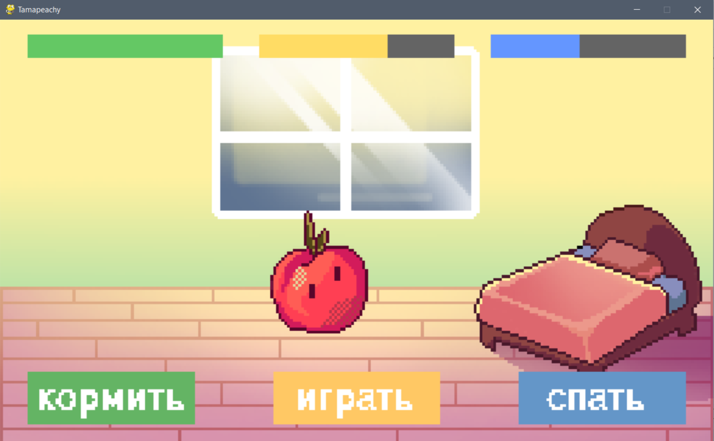

# tamapeachy

Тамагочи с персиком на Python + Pygame.

##  Скриншот

##  Как установить и запустить

1. Установиne Python
2. Установите Pygame
3. скопируйте файлы игры и запустите `tamapeachy.py`

##  Управление

 **мышь**

##  Механики

**Голод** - кормите персика, нажимая «кормить». Появится солнышко, персик подойдёт и съест его
**Счастье** - играйте с персиком, нажимая «играть». Появится мячик, персик будет за ним следить и радоваться
**Энергия** - укладывай персика спать, нажимая «спать». Он пойдёт к кровати и уснёт
**Параметры падают сами** - если не заботиться о персике, он загрустит, а потом впадёт в спячку
**Эмоции** - персик грустит, когда параметры низкие, и радуется во время игры

 

